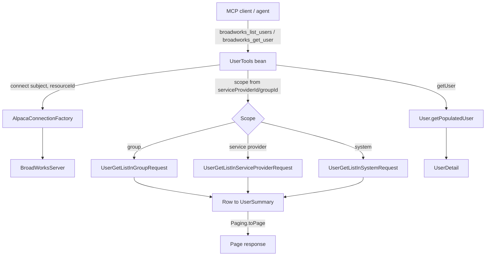

# Requirements

### Overview & Goals
Add a new MCP tool set, `UserTools`, that lets an agent **list/search BroadWorks users** at the system, service-provider, or group level, and **fetch a single user by id**. It mirrors the existing `GroupTools`/`ServiceProviderTools` beans: same authentication, connection resolution, compact columnar `Page` output, server-side pagination, and DTO mapping conventions.

### Scope

**In Scope**
- New tool `broadworks_list_users` — list (or search) users, scope derived from supplied ids.
- New tool `broadworks_get_user` — get one user by (system-unique) user id.
- New DTOs `UserSummary` (list rows) and `UserDetail` (single user).
- Register the new bean in `McpToolConfig` and keep the two tool-registration tests in sync.
- Unit tests for `UserTools` and documentation updates (`README.md`, `docs/mcp-tools-schema.md`).

**Out of Scope**
- Creating, modifying, or deleting users (no `UserAddRequest`/`UserModifyRequest`).
- User services, devices, registrations, or call-detail data.
- Any change to authentication, connection factory, or paging infrastructure.

### User Stories
- As an agent, I want to list all users in a group so that I can enumerate a group's membership.
- As an agent, I want to list users across a service provider or the whole system so that I can find users without knowing their group.
- As an agent, I want to filter users by last name, first name, user id, phone number, or email so that I can narrow large result sets.
- As an agent, I want to fetch a single user by id so that I can inspect their full profile.

### Functional Requirements
1. **`broadworks_list_users`** accepts optional `serviceProviderId`, `groupId`, the search params `lastName`, `firstName`, `userId`, `phoneNumber`, `emailAddress`, a shared `searchMode`, plus `cursor`, `limit`, and `resourceId`.
   - **Scope derivation (confirmed):** `serviceProviderId` + `groupId` ⇒ group scope; `serviceProviderId` only ⇒ service-provider scope; neither ⇒ system scope. (If `groupId` is supplied without `serviceProviderId`, fail with a clear message.)
   - **Search (confirmed):** each provided search field becomes an AND criterion; all use the single `searchMode` (`STARTSWITH`/`CONTAINS`/`EQUALTO`, default `CONTAINS`) via `AlpacaRequests.searchMode`. Omitting all fields lists everything in scope.
   - Results are paginated and capped server-side (`Paging.MAX_PAGE_LIMIT`), returning a compact columnar `Page` with `next_cursor`/`has_more`/`total_matching`.
2. **`broadworks_get_user`** accepts a required `userId` and optional `resourceId`, returning a `UserDetail`. A missing/inaccessible user yields a clear `AlpacaException` (mapped from `BroadWorksObjectException`).
3. **Summary columns (confirmed):** `userId`, `groupId`, `serviceProviderId`, `lastName`, `firstName`, `phoneNumber`, `extension`, `emailAddress`. `groupId`/`serviceProviderId` are filled from response rows when present and otherwise from the request parameters, so rows stay identifiable at every scope.

### Non-Functional Requirements
- No credentials or OCI protocol bodies logged; only debug-level parameter/summary logs like the existing tools.
- Every operation runs against the authenticated user's own connection resolved via `AlpacaConnectionFactory.connect(subject, resourceId)`.
- Behavior and coding conventions must stay consistent with `GroupTools`.

# Technical Design

### Current Implementation
The MCP tools live in `co.pitayagroup.mcp.broadworks.mcp.tools` and follow a uniform pattern (see `GroupTools.java`, `ServiceProviderTools.java`):
- `@Component @RequiredArgsConstructor` bean holding an `AlpacaConnectionFactory`; a private `connect(resourceId)` resolves `UserContext.current().subject()` to a `BroadWorksServer`.
- `@Tool`/`@ToolParam` annotated methods; list tools return `Page`, get tools return a detail record.
- Shared helpers: `Paging` (`decodeCursor`, `effectivePageLimit`, `toPage`), `AlpacaRequests` (`searchMode`, `ensureSuccess`), `ContactAddressMapper` (`toAddress`, `toContact`).
- Beans are wired in `config/McpToolConfig.java` via `MethodToolCallbackProvider.builder().toolObjects(...)`.

### Key Decisions
- **Scope by id presence (confirmed):** derive system/service-provider/group scope from `serviceProviderId`/`groupId`, matching `GroupTools`' "system-wide by omission" convention — no extra `scope` enum param.
- **Multiple optional search fields (confirmed):** expose `lastName`, `firstName`, `userId`, `phoneNumber`, `emailAddress` + one `searchMode`; AND-combine the provided ones. Phone maps to `SearchCriteriaDn`.
- **User id is system-unique:** `broadworks_get_user` needs only `userId` (unlike `getGroup`, which needs `serviceProviderId`), using `User.getPopulatedUser(server, userId)`.
- **Fill scope ids from params when rows omit them:** group-scope rows (`UserUserTable1Row`) carry neither id; service-provider-scope rows (`UserUserTable2Row`) carry `groupId` only; system-scope rows (`UserUserTable3Row`) carry both. Missing ids are backfilled from the request params so the summary schema is uniform.

### Proposed Changes

**New DTOs** in `co.pitayagroup.mcp.broadworks.mcp.model`:
- `UserSummary(String userId, String groupId, String serviceProviderId, String lastName, String firstName, String phoneNumber, String extension, String emailAddress)`.
- `UserDetail(String userId, String groupId, String serviceProviderId, String firstName, String lastName, String phoneNumber, String extension, String emailAddress, String department, String title, String mobilePhoneNumber, String timeZone, String language, String callingLineIdFirstName, String callingLineIdLastName, String callingLineIdPhoneNumber, AddressInfo address)`.

**New `UserTools`** bean modeled on `GroupTools`:
- `SCHEMA = List.of("userId", "groupId", "serviceProviderId", "lastName", "firstName", "phoneNumber", "extension", "emailAddress")`.
- `listUsers(...)` decodes the cursor, computes `effectivePageLimit(limit, SCHEMA.size())`, resolves `searchMode`, connects, dispatches to one of three private search methods by scope, maps rows → `UserSummary`, and returns `toPage(...)`. Wrapped in the same `AlpacaException`/`RuntimeException` handling as `GroupTools.listGroups`.
- `getUser(userId, resourceId)` calls `User.getPopulatedUser(server, userId)` and maps to `UserDetail`, mapping `BroadWorksObjectException` → `AlpacaException("User not found or not accessible: " + userId)`.
- Private helpers `searchUsersInGroup/InServiceProvider/InSystem` build the matching Alpaca request, apply the AND search criteria, `fire()`, `AlpacaRequests.ensureSuccess(...)`, and map the scope-specific row type to `UserSummary` (backfilling `groupId`/`serviceProviderId` from params where absent).
- A private `applySearch(...)` (or inline per branch) constructs `SearchCriteriaUserLastName/UserFirstName/UserId/Dn/EmailAddress` `(mode, value.trim(), true)` for each non-blank field.

**Registration** in `config/McpToolConfig.java`: add a `UserTools userTools` parameter and include it in `.toolObjects(...)`.

### Data Models / Contracts
Alpaca request/response mapping per scope:

 Scope | Request | Row type | Row provides |
---|---|---|---|
 Group | `User.UserGetListInGroupRequest(serviceProvider, groupId)` | `UserUserTable1Row` | userId, names, phoneNumber, extension, email (no group/SP id) |
 Service provider | `User.UserGetListInServiceProviderRequest(serviceProvider)` | `UserUserTable2Row` | + groupId |
 System | `User.UserGetListInSystemRequest(server)` | `UserUserTable3Row` | + groupId + serviceProviderId |

Search criteria (all three requests support these setters; ctor `(SearchMode, String, Boolean)`):
`SearchCriteriaUserLastName`, `SearchCriteriaUserFirstName`, `SearchCriteriaUserId`, `SearchCriteriaDn` (phone), `SearchCriteriaEmailAddress`.

Detail getters used from `User`/`BroadWorksUser`: `getUserId()`, `getGroupId()`, `getServiceProviderId()`, `getFirstName()`, `getLastName()`, `getPhoneNumber()`, `getExtension()`, `getEmailAddress()`, `getDepartmentFullPath()`, `getTitle()`, `getMobilePhoneNumber()`, `getTimeZone()`, `getLanguage()`, `getCallingLineIdFirstName()`, `getCallingLineIdLastName()`, `getCallingLineIdPhoneNumber()`, `getAddress()` (`StreetAddress` → `ContactAddressMapper.toAddress`).

### File Structure
- **Add** `src/main/java/co/pitayagroup/mcp/broadworks/mcp/model/UserSummary.java`
- **Add** `src/main/java/co/pitayagroup/mcp/broadworks/mcp/model/UserDetail.java`
- **Add** `src/main/java/co/pitayagroup/mcp/broadworks/mcp/tools/UserTools.java`
- **Modify** `src/main/java/co/pitayagroup/mcp/broadworks/config/McpToolConfig.java`
- **Add** `src/test/java/co/pitayagroup/mcp/broadworks/mcp/tools/UserToolsTest.java`
- **Modify** `src/test/java/co/pitayagroup/mcp/broadworks/mcp/tools/ToolRegistrationProbeTest.java`
- **Modify** `src/test/java/co/pitayagroup/mcp/broadworks/mcp/McpToolsListIntegrationTest.java`
- **Modify** `README.md` and `docs/mcp-tools-schema.md`

### Architecture Diagram

### Risks
- **Row-type divergence:** the three scope levels return different row classes; the mapping must backfill `groupId`/`serviceProviderId` from params where the row lacks them. Covered by per-scope unit tests.
- **`groupId` without `serviceProviderId`:** invalid for group scope — must fail fast with a clear message rather than silently falling back to system scope.
- **Large result sets:** relies on the existing server-side cell-budget cap in `Paging`; no change needed but must pass `SCHEMA.size()` to `effectivePageLimit`.
- **`department` shape:** `User.getDepartment()` returns a `DepartmentKey`; use `getDepartmentFullPath()` (plain `String`) for the DTO to avoid extra mapping.

# Testing

### Validation Approach
Add a `UserToolsTest` mirroring `GroupToolsTest`, using Mockito `mockConstruction` for the Alpaca request classes and `mockStatic` for `User.getPopulatedUser`, plus the existing `SecurityContextHolder` principal setup so `UserContext.current()` resolves. Keep the tool-registration guards (`ToolRegistrationProbeTest`, `McpToolsListIntegrationTest`) in sync. Build/compile the project to confirm the new code and Alpaca API usage are valid.

### Key Scenarios
- **Group scope:** `serviceProviderId` + `groupId` supplied → `UserGetListInGroupRequest` constructed; `UserUserTable1Row` mapped to a `UserSummary` whose `groupId`/`serviceProviderId` are backfilled from params; schema and paging metadata correct.
- **Service-provider scope:** `serviceProviderId` only → `UserGetListInServiceProviderRequest`; `groupId` taken from row, `serviceProviderId` from param.
- **System scope:** no ids → `UserGetListInSystemRequest`; both ids taken from the row.
- **Search mapping:** providing `lastName`+`emailAddress` sets the corresponding `SearchCriteria*` with the resolved `searchMode`; omitting all search fields sets none.
- **`broadworks_get_user`:** `getPopulatedUser` result mapped fully to `UserDetail`, including address via `ContactAddressMapper.toAddress`.
- **Registration:** both `ToolRegistrationProbeTest` and `McpToolsListIntegrationTest` include `broadworks_list_users` and `broadworks_get_user`.

### Edge Cases
- Null/empty user table → empty `Page` (returned/total = 0, `hasMore=false`).
- `groupId` supplied without `serviceProviderId` → `AlpacaException` with a clear message.
- `getUser` on unknown id → `BroadWorksObjectException` mapped to `AlpacaException("User not found or not accessible: ...")`.
- Null contact/address / null optional detail fields map to `null` without NPEs.

### Test Changes
- **Add** `UserToolsTest` (list per-scope, search mapping, empty-table, `toPage`, `getUser` happy path + not-found).
- **Update** `ToolRegistrationProbeTest` to add `new UserTools(null)` and the two new tool names.
- **Update** `McpToolsListIntegrationTest` to assert the two new tool names are exposed over the wire.

# Delivery Steps

### ✓ Step 1: Add UserSummary and UserDetail DTOs
The model package exposes the two records the new tools return.

- Add `model/UserSummary.java` as a record with `userId`, `groupId`, `serviceProviderId`, `lastName`, `firstName`, `phoneNumber`, `extension`, `emailAddress` (all `String`), with Javadoc matching `GroupSummary` style.
- Add `model/UserDetail.java` as a record with `userId`, `groupId`, `serviceProviderId`, `firstName`, `lastName`, `phoneNumber`, `extension`, `emailAddress`, `department`, `title`, `mobilePhoneNumber`, `timeZone`, `language`, `callingLineIdFirstName`, `callingLineIdLastName`, `callingLineIdPhoneNumber`, and an `AddressInfo address`, with Javadoc matching `GroupDetail` style.

### ✓ Step 2: Implement broadworks_list_users with scope derivation, multi-field search, and paging
`UserTools.listUsers` returns a paginated `Page` of users at the correct scope with AND-combined search.

- Create `tools/UserTools.java` as an `@Slf4j @Component @RequiredArgsConstructor` bean holding `AlpacaConnectionFactory`, with the same private `connect(resourceId)` helper as `GroupTools`.
- Define `SCHEMA = List.of("userId","groupId","serviceProviderId","lastName","firstName","phoneNumber","extension","emailAddress")`.
- Add `@Tool(name = "broadworks_list_users")` with `@ToolParam`s: `serviceProviderId`, `groupId`, `lastName`, `firstName`, `userId`, `phoneNumber`, `emailAddress`, `searchMode`, `cursor`, `limit`, `resourceId` (all optional), with clear descriptions of scope derivation and pagination.
- Derive scope from id presence; reject `groupId` without `serviceProviderId` with a clear `AlpacaException`.
- Implement private `searchUsersInGroup` (`UserGetListInGroupRequest(serviceProvider, groupId)` → `UserUserTable1Row`), `searchUsersInServiceProvider` (`UserGetListInServiceProviderRequest(serviceProvider)` → `UserUserTable2Row`), and `searchUsersInSystem` (`UserGetListInSystemRequest(server)` → `UserUserTable3Row`), each applying `SearchCriteriaUserLastName/UserFirstName/UserId/Dn/EmailAddress` `(mode, value.trim(), true)` for each non-blank field, calling `AlpacaRequests.ensureSuccess`, and mapping rows to `UserSummary` (backfilling `groupId`/`serviceProviderId` from params where the row omits them).
- Add a static `toPage(List<UserSummary>, offset, pageLimit)` delegating to `Paging.toPage(SCHEMA, rows, ..., "broadworks_list_users", "users")`, with the same try/catch error wrapping as `GroupTools.listGroups`.
- Add unit tests in `UserToolsTest` covering all three scopes, search-criteria mapping, empty-table handling, and `toPage` pagination metadata.

### ✓ Step 3: Implement broadworks_get_user and register the UserTools bean
`broadworks_get_user` returns a full `UserDetail` by id and the tool set is discoverable.

- Add `@Tool(name = "broadworks_get_user")` `getUser(userId, resourceId)` to `UserTools`, calling `User.getPopulatedUser(server, userId)` and mapping to `UserDetail` (department via `getDepartmentFullPath()`, address via `ContactAddressMapper.toAddress(user.getAddress())`), mapping `BroadWorksObjectException` to `AlpacaException("User not found or not accessible: " + userId)`.
- Update `config/McpToolConfig.java` to accept a `UserTools userTools` parameter and add it to `.toolObjects(...)`.
- Update `ToolRegistrationProbeTest` to construct `new UserTools(null)` and assert `broadworks_list_users` and `broadworks_get_user` are discovered.
- Update `McpToolsListIntegrationTest` to assert both new tool names are returned over the stateless HTTP `tools/list`.
- Add `getUser` unit tests (happy path mapping and not-found) to `UserToolsTest`, then build the project to confirm compilation and Alpaca API usage.

### ✓ Step 4: Document the new user tools
The docs list the two new tools alongside the existing ones.

- Add `broadworks_list_users` and `broadworks_get_user` rows to the tools table in `README.md`.
- Add the two tools to the summary table in `docs/mcp-tools-schema.md` and a new "User tools" section documenting parameters, scope derivation, search fields, and the `Page`/`UserDetail` return shapes, consistent with the existing Group tools documentation.