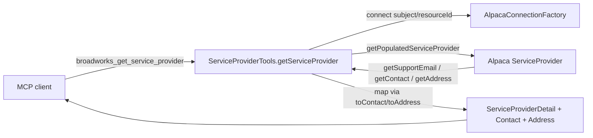

# Requirements

### Overview & Goals

The MCP tool for fetching a single BroadWorks service provider by id already exists: `broadworks_get_service_provider` in `ServiceProviderTools.getServiceProvider(...)` (lines 125-148). Today it returns only 5 basic fields via the `ServiceProviderDetail` record: `serviceProviderId`, `serviceProviderName`, `defaultDomain`, `enterprise`, `resellerId`.

This change **enriches the existing tool** so a single lookup also returns the service provider's **support email, contact, and address** details, which the underlying Alpaca `ServiceProvider` object already exposes but the tool currently discards.

### Scope

**In Scope**
- Extend the response DTO (`ServiceProviderDetail`) with support email, contact, and address information.
- Map the additional fields from the populated Alpaca `ServiceProvider` object inside `getServiceProvider(...)`.
- Update the tool's `@Tool` description to reflect the richer output.
- Update/extend the existing unit test to assert the new fields.

**Out of Scope**
- The list tool (`broadworks_list_service_providers`) and its `ServiceProviderSummary` DTO remain unchanged (list stays compact/columnar).
- Other fields the user did not request (external id, class name, policies, data center, partition, slice ids, language/routing flags) are intentionally excluded for now.
- No changes to authentication, connection resolution, or paging.

### User Stories
- As an operator using the MCP, I want `broadworks_get_service_provider` to return the support email, contact person, and physical address so that I can reach and locate a service provider without a second lookup.

### Functional Requirements
- Calling `broadworks_get_service_provider` with a valid id returns the existing 5 fields **plus** `supportEmail`, a nested `contact` object, and a nested `address` object.
- `contact` contains `contactName`, `contactNumber`, `contactEmail`.
- `address` contains `addressLine1`, `addressLine2`, `city`, `stateOrProvince`, `zipOrPostalCode`, `country`.
- When the source contact or address is absent, the corresponding nested object is `null` (or its individual fields are `null`); the call must not fail.
- Error behavior is unchanged: an unknown/inaccessible id still yields an `AlpacaException` ("Service provider not found or not accessible: <id>").

### Non-Functional Requirements
- Backward compatible: existing fields keep their names and types; only additive changes.
- No credentials or protocol bodies logged (existing convention preserved).

# Technical Design

### Current Implementation

`ServiceProviderTools.getServiceProvider(...)` (lines 125-148) resolves the tenant connection via `connect(resourceId)`, calls `ServiceProvider.getPopulatedServiceProvider(server, serviceProviderId)`, and maps a subset of getters into the flat `ServiceProviderDetail` record (`src/main/java/.../mcp/model/ServiceProviderDetail.java`). `BroadWorksObjectException` is translated into `AlpacaException`.

The populated Alpaca `ServiceProvider` object also exposes:
- `String getSupportEmail()`
- `Contact getContact()` → `Optional<String> getContactName()/getContactNumber()/getContactEmail()`
- `StreetAddress getAddress()` → `Optional<String> getAddressLine1()/getAddressLine2()/getCity()/getStateOrProvince()/getZipOrPostalCode()/getCountry()`

### Key Decisions
- **Nested records over flattening.** Introduce two small record types, `ServiceProviderContact` and `ServiceProviderAddress`, and reference them from `ServiceProviderDetail`. Rationale: mirrors the toolkit's own `Contact`/`StreetAddress` grouping, keeps the JSON output well-structured, and lets the whole group be `null` when absent. (Alternative considered: flat fields like `contactName`, `addressCity` — rejected as noisier and less clear.)
- **Unwrap `Optional` to plain nullable `String`.** DTO fields are plain `String` populated via `opt.orElse(null)`, consistent with the existing flat-value style of the project's DTOs and JSON-friendly output.
- **Null-safe mapping.** `getContact()`/`getAddress()` may return `null`; guard before dereferencing so absent groups produce a `null` nested object rather than an exception.
- **Enrich, don't fork.** Modify the existing `ServiceProviderDetail` + tool rather than add a second tool, per user selection — avoids duplicate tools and keeps a single source of truth.

### Proposed Changes
1. **New model records** in `co.pitayagroup.mcp.broadworks.mcp.model`:
   - `ServiceProviderContact(String contactName, String contactNumber, String contactEmail)`
   - `ServiceProviderAddress(String addressLine1, String addressLine2, String city, String stateOrProvince, String zipOrPostalCode, String country)`
2. **Extend `ServiceProviderDetail`** to add `String supportEmail`, `ServiceProviderContact contact`, `ServiceProviderAddress address` after the existing fields (existing fields/order preserved).
3. **Update `getServiceProvider(...)`** to map the new fields from the populated `ServiceProvider`, using small private helpers `toContact(Contact)` and `toAddress(StreetAddress)` that return `null` when the source is `null` and otherwise unwrap each `Optional` via `orElse(null)`.
4. **Update the `@Tool` description** of `broadworks_get_service_provider` to note it now returns support email, contact, and address.

### Data Models / Contracts
```java
public record ServiceProviderContact(String contactName, String contactNumber, String contactEmail) {}

public record ServiceProviderAddress(String addressLine1, String addressLine2, String city,
                                     String stateOrProvince, String zipOrPostalCode, String country) {}

public record ServiceProviderDetail(String serviceProviderId, String serviceProviderName,
                                    String defaultDomain, boolean enterprise, String resellerId,
                                    String supportEmail, ServiceProviderContact contact,
                                    ServiceProviderAddress address) {}
```
```java
// inside getServiceProvider, after fetching sp
return new ServiceProviderDetail(
        sp.getServiceProviderId(), sp.getServiceProviderName(), sp.getDefaultDomain(),
        Boolean.TRUE.equals(sp.getIsEnterprise()), sp.getResellerId(),
        sp.getSupportEmail(), toContact(sp.getContact()), toAddress(sp.getAddress()));
```

### File Structure
- Added: `src/main/java/co/pitayagroup/mcp/broadworks/mcp/model/ServiceProviderContact.java`
- Added: `src/main/java/co/pitayagroup/mcp/broadworks/mcp/model/ServiceProviderAddress.java`
- Modified: `src/main/java/co/pitayagroup/mcp/broadworks/mcp/model/ServiceProviderDetail.java`
- Modified: `src/main/java/co/pitayagroup/mcp/broadworks/mcp/tools/ServiceProviderTools.java`
- Modified: `src/test/java/co/pitayagroup/mcp/broadworks/mcp/tools/ServiceProviderToolsTest.java`

### Architecture Diagram


### Risks
- **Optional handling**: `Contact`/`StreetAddress` getters return `Optional<String>`; forgetting to unwrap would break serialization. Mitigated by helper methods using `orElse(null)`.
- **Null groups**: `getContact()`/`getAddress()` may be `null`; guarded in helpers.
- **Test mocks**: the existing test mocks `ServiceProvider`; new getters must be stubbed or they return `null`/empty, which the assertions must reflect.

# Testing

### Validation Approach
Extend the existing JUnit + Mockito test class `ServiceProviderToolsTest` so the enriched mapping is asserted, and run the module test suite with Maven.

### Key Scenarios
- **Full detail mapping** (extend `getServiceProviderMapsToDetail`): stub `sp.getSupportEmail()`, and a mocked `Contact` (`getContactName/Number/Email` returning `Optional.of(...)`) and mocked `StreetAddress` (address getters returning `Optional.of(...)`); assert the returned `ServiceProviderDetail` includes the new `supportEmail`, `ServiceProviderContact`, and `ServiceProviderAddress` values alongside the original fields.
- **Unchanged error path**: `getPopulatedServiceProvider` throwing `BroadWorksObjectException` still yields `AlpacaException` with the not-found message (retain/confirm existing coverage).

### Edge Cases
- **Absent contact/address**: `sp.getContact()` and `sp.getAddress()` return `null` → `contact` and `address` are `null` in the result and no exception is thrown.
- **Empty optionals**: contact/address present but individual getters return `Optional.empty()` → corresponding fields map to `null`.

### Test Changes
- Update `getServiceProviderMapsToDetail` to stub and assert the new fields.
- Add one test for the null contact/address case.
- Run `./mvnw test` (or `mvn test`) to confirm the suite passes.

# Delivery Steps

### ✓ Step 1: Add contact and address model records and extend ServiceProviderDetail
`ServiceProviderDetail` carries support email plus nested contact and address information.

- Add `ServiceProviderContact` record in `mcp/model` with `contactName`, `contactNumber`, `contactEmail` (all `String`).
- Add `ServiceProviderAddress` record in `mcp/model` with `addressLine1`, `addressLine2`, `city`, `stateOrProvince`, `zipOrPostalCode`, `country` (all `String`).
- Extend `ServiceProviderDetail` to append `String supportEmail`, `ServiceProviderContact contact`, and `ServiceProviderAddress address` after the existing fields, keeping existing field names/order and updating the Javadoc.

### ✓ Step 2: Enrich getServiceProvider mapping and tool description
`broadworks_get_service_provider` returns the new support email, contact, and address fields.

- In `ServiceProviderTools.getServiceProvider(...)`, populate the extended `ServiceProviderDetail` from `sp.getSupportEmail()`, `sp.getContact()`, and `sp.getAddress()`.
- Add private helpers `toContact(Contact)` and `toAddress(StreetAddress)` that return `null` when the source is `null` and otherwise unwrap each `Optional<String>` via `orElse(null)`.
- Add the required imports for `Contact` and `StreetAddress` datatypes.
- Update the `@Tool` description of `broadworks_get_service_provider` to mention it now includes support email, contact, and address.

### ✓ Step 3: Update unit tests for the enriched detail
Tests assert the enriched mapping and null-safe behavior, and the suite passes.

- Extend `getServiceProviderMapsToDetail` in `ServiceProviderToolsTest` to stub `getSupportEmail`, a mocked `Contact`, and a mocked `StreetAddress`, and assert the new fields on the returned `ServiceProviderDetail`.
- Add a test verifying that when `getContact()`/`getAddress()` return `null`, the resulting `contact`/`address` are `null` and no exception is thrown.
- Run `mvn test` to confirm all `ServiceProviderTools` tests pass.