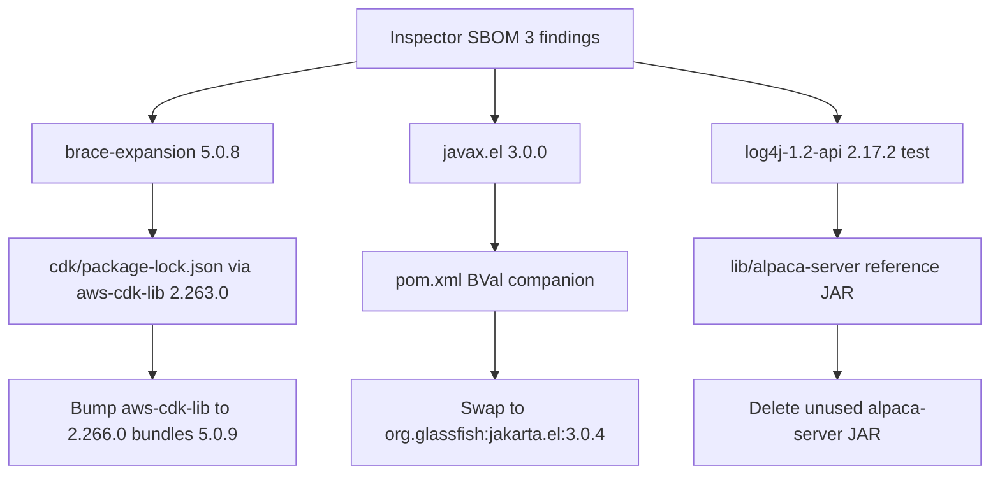

# Requirements

### Overview & Goals

Clear the three Amazon Inspector findings in `/Users/jpuckett/Downloads/sbom.json` (CycloneDX 1.5 source-tree scan: 0 critical, 2 high, 1 medium) without changing application behavior.

The scan is of the **repository**, not the Fargate runtime image. Two findings are real dependencies we ship or run at deploy time; one is a test-scoped POM declaration inside an unused reference JAR that is not on the classpath and does not even contain the vulnerable classes.

### Scope

#### In Scope

- **CVE-2026-69152** (High, CVSS 7.5) — `brace-expansion@5.0.8` bundled inside `aws-cdk-lib` (`cdk/package-lock.json`). Unbounded `expand()` can exhaust memory / block the event loop. Fixed in `5.0.9`.
- **CVE-2026-34479** (High) — `org.apache.logging.log4j:log4j-1.2-api:2.17.2` declared `scope=test` in `lib/alpaca-server-12.2.0-RELEASE-26.jar`'s embedded POM. Log4j1XmlLayout can emit malformed XML. Fixed in `2.25.4`.
- **CVE-2021-28170** (Medium, CVSS 5.3) — `org.glassfish:javax.el:3.0.0` declared in root `pom.xml`. Invalid EL expressions can be evaluated. Fixed in `org.glassfish:jakarta.el:3.0.4`.

#### Out of Scope

- Unrelated items already tracked in `docs/security-todo.md` (ancient JCS / `concurrent:1.0`, Dependabot / OWASP dependency-check, WAF leftovers).
- Frontend (`src/main/frontend`) — no `brace-expansion` copy there.
- CDK CLI (`aws-cdk@2.1135.1`) — not the flagged package.
- Broader Alpaca toolkit upgrades.

### User Stories

- As an operator, I want Inspector to report zero known vulnerabilities on the next SBOM scan so the finding queue stays empty.
- As a developer, I want the remediations to be version bumps / tree cleanup only, so BroadWorks login, Bean Validation, and `cdk synth` keep working.

### Functional Requirements

- After `npm install` in `cdk/`, the lockfile must resolve `aws-cdk-lib`'s bundled `brace-expansion` to **5.0.9 or newer**.
- Root `pom.xml` must no longer declare `org.glassfish:javax.el:3.0.0`. Apache BVal 2.0.6 must still have a **javax.el.*** implementation for constraint-message interpolation.
- `lib/alpaca-server-*.jar` must not remain in the tree Inspector scans (it is already not installed, not a Maven dependency, and not copied into the runtime image).
- Existing Maven tests and `cdk` TypeScript build must still pass.

### Non-Functional Requirements

- No runtime behavior change for the MCP server or OAuth flows.
- Do not pull Spring Boot 2.7 / `javax` transitives from Alpaca (existing `install-alpaca` contract).
- Keep comments in `pom.xml`, `scripts/install-alpaca.sh`, and `README.md` accurate after the cleanup.

# Technical Design

### Current Implementation

Inspector scanned the source tree and reported exactly three vulnerabilities:

| CVE | Severity | Component | Path in SBOM |
|---|---|---|---|
| CVE-2026-69152 | High 7.5 (DoS) | `pkg:npm/brace-expansion@5.0.8` | `cdk/package-lock.json` |
| CVE-2026-34479 | High (malformed XML logs) | `pkg:maven/org.apache.logging.log4j/log4j-1.2-api@2.17.2?scope=test` | `lib/alpaca-server-12.2.0-RELEASE-26.jar/META-INF/maven/co.ecg/alpaca-server/pom.xml` |
| CVE-2021-28170 | Medium 5.3 (invalid EL accepted) | `pkg:maven/org.glassfish/javax.el@3.0.0` | `pom.xml` |

**brace-expansion.** `cdk/package.json` depends on `aws-cdk-lib: ^2.160.0`; the lockfile has `aws-cdk-lib@2.263.0`, which **bundles** `brace-expansion@5.0.8` (`inBundle: true` at `node_modules/aws-cdk-lib/node_modules/brace-expansion`). A second copy, `brace-expansion@1.1.18`, is already patched and was marked clean. This is deploy-time only (CDK synth/deploy), not the Fargate image.

**javax.el.** Direct companion of Apache BVal 2.0.6 in root `pom.xml` (lines 316–331). BVal is the **javax.validation** provider the Alpaca toolkit needs; Boot 4's Hibernate Validator 9 only covers `jakarta.validation`. BVal interpolates constraint messages via EL 3.0; Tomcat's `tomcat-embed-el` is the jakarta namespace, so `org.glassfish:javax.el:3.0.0` was added. No application source imports `javax.el`.

**log4j-1.2-api.** Not a project dependency. `scripts/install-alpaca.sh` and `README.md` already say `alpaca-server-*.jar` is **reference only and is not installed**. The install-alpaca Maven profile does not install it. The runtime `Dockerfile` copies only `target/broadworks-mcp-*.jar`. Unpacking `lib/*.jar` shows **no log4j classes in any Alpaca JAR** — Inspector flagged a test-scoped POM coordinate inside the unused server fat-jar.



### Key Decisions

1. **Bump `aws-cdk-lib` rather than npm `overrides`.** `brace-expansion@5.0.8` is an *in-bundle* copy. Overrides do not reliably replace bundled packages. `aws-cdk-lib@2.266.0` already vendors `brace-expansion@5.0.9` (verified against the published tarball). Raise the `package.json` floor to `^2.266.0` and refresh the lockfile.

2. **Replace coordinates, do not bump `javax.el`.** `org.glassfish:javax.el` tops out at `3.0.1-b12` (2020), still in the affected range. `org.glassfish:jakarta.el:3.0.4` is the patched EL 3.0 RI and still ships **`javax.el.*`** classes, so it stays compatible with BVal 2.0.6 and does not collide with `tomcat-embed-el` (`jakarta.el.*`). Do **not** use 4.x / 5.x — those are the jakarta namespace.

3. **Delete the unused `alpaca-server` JAR instead of forcing a Log4j upgrade.** We do not control Alpaca's POM, the coordinate is test-scoped, the classes are not in the JAR, and the artifact is already excluded from Maven and the runtime image. Leaving it in `lib/` will keep Inspector red. Removing it is the fix; comments in `install-alpaca.sh` / `README.md` will be updated so nobody re-adds it "for completeness".

### Proposed Changes

**CDK (CVE-2026-69152)**

- In `cdk/package.json`, change `aws-cdk-lib` from `^2.160.0` to `^2.266.0`.
- In `cdk/`, run `npm install` to refresh `package-lock.json` so `node_modules/aws-cdk-lib/node_modules/brace-expansion` is `5.0.9`.
- Leave `aws-cdk` CLI as-is (not in the finding).

**Maven EL (CVE-2021-28170)**

Replace in `pom.xml`:

```xml
<dependency>
    <groupId>org.glassfish</groupId>
    <artifactId>javax.el</artifactId>
    <version>3.0.0</version>
</dependency>
```

with:

```xml
<dependency>
    <groupId>org.glassfish</groupId>
    <artifactId>jakarta.el</artifactId>
    <version>3.0.4</version>
</dependency>
```

Update the adjacent comment so it names `jakarta.el` 3.0.4 (still `javax.el.*`) instead of `javax.el` 3.0.0.

**Alpaca server JAR (CVE-2026-34479)**

- Delete `lib/alpaca-server-12.2.0-RELEASE-26.jar`.
- `scripts/install-alpaca.sh`: change the NOTE from "kept in lib/ for reference ONLY" to "do not add alpaca-server-*.jar; Inspector flags its test-scoped Log4j POM and it is not used."
- `README.md` prerequisites: drop the parenthetical about keeping `alpaca-server-…jar` for reference.

### File Structure

- Modify: `cdk/package.json`, `cdk/package-lock.json`
- Modify: `pom.xml`
- Modify: `scripts/install-alpaca.sh`, `README.md`
- Delete: `lib/alpaca-server-12.2.0-RELEASE-26.jar`

### Risks

- **`aws-cdk-lib` 2.263.0 → 2.266.0.** CDK 2.x is backward compatible; still run `npm test` / `npx cdk synth` (or `tsc`) in `cdk/` in case construct APIs shifted.
- **EL swap.** Low risk (same `javax.el` packages, BVal-only). Residual: if a future Inspector rule still maps the old `javax.el` PURL, confirm the resolved tree is `jakarta.el:3.0.4` via `mvn dependency:tree`.
- **Deleting `alpaca-server`.** Irreversible without re-obtaining the ECG JAR. Acceptable: it is unused, undocumented as a runtime dep, and not installed by our scripts.

# Testing

### Validation Approach

Verify each finding is gone from the *resolved* trees Inspector would scan, and that existing builds still work. No new product tests are required; these are dependency/tree changes.

### Key Scenarios

- **CDK lockfile:** `cdk/package-lock.json` lists `node_modules/aws-cdk-lib/node_modules/brace-expansion` at `5.0.9`. `npm ls brace-expansion` in `cdk/` shows no `5.0.8`.
- **CDK still builds:** `npm test` (or at least `npx tsc --noEmit`) in `cdk/` succeeds.
- **Maven EL:** `mvn -q dependency:tree -Dincludes=org.glassfish:jakarta.el,org.glassfish:javax.el` shows `jakarta.el:3.0.4` and no `javax.el:3.0.0`.
- **App tests:** existing Maven test suite still passes (BVal remains able to start; no application code imports `javax.el`).
- **Alpaca server gone:** `lib/` contains only the four toolkit JARs plus `ecg-licensing`; no `alpaca-server-*`.

### Edge Cases

- A fresh `npm install` in `cdk/` must not resolve `aws-cdk-lib` back below 2.266.0 — that is why the `package.json` floor is raised, not just the lockfile.
- Confirm `jakarta.el` 3.0.4 did not pull `jakarta.el` 4/5 (wrong namespace) via any BOM.
- Confirm we did not start installing `alpaca-server` in `scripts/install-alpaca.sh` or the `install-alpaca` profile.

### Test Changes

- No new test classes.
- Re-run existing `cdk` and Maven test suites as part of the corresponding stages.

# Delivery Steps

### ✓ Step 1: Patch CDK brace-expansion via aws-cdk-lib 2.266.0
Inspector no longer sees brace-expansion 5.0.8; the CDK lockfile vendors 5.0.9.

- Raise `aws-cdk-lib` in `cdk/package.json` from `^2.160.0` to `^2.266.0` (2.266.0 already bundles `brace-expansion@5.0.9`).
- Run `npm install` in `cdk/` to refresh `package-lock.json`.
- Confirm `node_modules/aws-cdk-lib/node_modules/brace-expansion` is `5.0.9` and that `npm ls brace-expansion` has no `5.0.8`.
- Do not add npm `overrides` (they do not reliably replace `inBundle` copies).
- Leave the `aws-cdk` CLI version unchanged.
- Run the existing CDK test / TypeScript compile to catch any 2.263 → 2.266 construct drift.

### ✓ Step 2: Replace vulnerable javax.el 3.0.0 with jakarta.el 3.0.4
BVal still interpolates javax.el messages, but the patched EL 3.0 RI is what Maven resolves.

- In root `pom.xml`, replace `org.glassfish:javax.el:3.0.0` with `org.glassfish:jakarta.el:3.0.4`.
- Update the comment above that dependency: 3.0.4 still provides `javax.el.*` (required by BVal 2.0.6) and must not be upgraded to 4.x/5.x (`jakarta.el.*`).
- Do not touch `bval-jsr`, `validation-api`, or Hibernate Validator 9 — the dual javax/jakarta provider split stays as designed.
- Verify with `mvn dependency:tree` that `javax.el:3.0.0` is gone and `jakarta.el:3.0.4` is present.
- Run the existing Maven test suite to confirm the Alpaca/BVal classpath still starts.

### ✓ Step 3: Remove unused alpaca-server JAR that triggers the Log4j finding
The Log4j 1.2 API finding disappears because the unused reference JAR is no longer in the scanned tree.

- Delete `lib/alpaca-server-12.2.0-RELEASE-26.jar`. It is not installed by `scripts/install-alpaca.sh` or the `install-alpaca` profile, is not a `pom.xml` dependency, is not in the runtime image, and contains no log4j classes — Inspector is flagging a test-scoped POM coordinate only.
- Update the NOTE in `scripts/install-alpaca.sh` so it says not to add `alpaca-server-*.jar` (Inspector flags its embedded test-scoped Log4j POM).
- Remove the README prerequisites line that says `alpaca-server-…jar` is kept for reference.
- Do not add a Log4j version override; we never resolve that artifact.
- Confirm `lib/` is only `alpaca-{commons,model,core,library}` plus `ecg-licensing`.