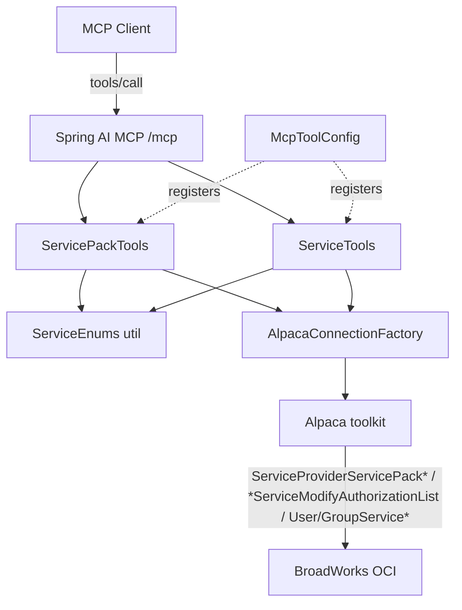

# Requirements

### Overview & Goals
Extend the BroadWorks MCP server so an admin can inspect and manage **services** and **service packs** at the three provisioning levels that already have create/list/modify tools (service provider, group, user). This builds directly on the existing `ServiceProviderTools` / `GroupTools` / `UserTools` tool sets and the Alpaca toolkit.

BroadWorks models this as three distinct concepts, all exposed as new `@Tool`s:
- **Service pack definitions** — named bundles of user services that live on a *service provider* (create / read / modify / delete).
- **Service authorization** — how many of each user service, group service, and service pack a *service provider* grants to itself and a *group* grants to itself (quantities, unlimited, or unauthorized).
- **Service assignment / activation** — which group services are assigned to a *group*, and which user services + service packs are assigned to a *user*.

### Scope
#### In Scope
- Read/inspect tools for authorization and assignment at all three levels, plus service pack listing/detail.
- Authorization mutation at the service-provider and group levels.
- Group-service and user-service/service-pack assignment & unassignment.
- Service pack CRUD (create, modify, delete) at the service-provider level.
- New model DTOs, shared enum/quantity helpers, tool registration, unit tests, and documentation updates.

#### Out of Scope
- Service-pack **migration tasks** (`...ServicePackMigrationTask*` requests) — a separate, heavier subsystem.
- Network Class of Service assignment, schedules, and other per-service configuration.
- Bulk operations across all users in a group (`GroupExistingUsersAssignUserServiceList`, new-user templates).
- Any UI; tools are MCP-only, consistent with the current server.

### User Stories
- As an admin, I want to list and inspect the service packs defined on a service provider so I know what bundles exist and how they are consumed.
- As an admin, I want to create, modify, and delete a service pack. **Confirmed modifiable elements** (via `ServiceProviderServicePackModifyRequest`): the pack **name** (`setNewServicePackName`), **description** (`setServicePackDescription` / clearable via `unsetServicePackDescription`), **availability** (`setIsAvailableForUse`), and **quantity** (`setServicePackQuantity`, positive int or unlimited). The **included user services are NOT modifiable in-place**: the modify request has no service-name setter. At creation the full service list is set (`ServiceProviderServicePackAddRequest.setServiceName(...)`); afterward services can only be **added** to an existing pack (`ServiceProviderServicePackAddServiceListRequest`) — the toolkit provides **no remove/replace-service request**, so removing a service requires deleting and recreating the pack (or a migration task, which is out of scope).
- As an admin, I want to view and change which user/group services and service packs are authorized at the service-provider and group levels.
- As an admin, I want to assign or unassign group services to a group, and user services / service packs to an individual user.

### Functional Requirements
- Every mutating tool clearly states in its description that it mutates live BroadWorks data, mirroring the existing create/modify tools.
- Service names are supplied as their BroadWorks display strings (e.g. `Call Waiting`) and validated against the Alpaca `UserService` / `GroupService` enums; an invalid name returns a clear error listing that it is unknown.
- Quantities accept either a positive integer or an `unlimited` flag; authorization additionally supports an `unauthorized` state to revoke.
- Read tools return compact DTOs (no live credentials/protocol bodies logged), consistent with existing tools.
- Each tool resolves the caller's BroadWorks connection via `AlpacaConnectionFactory` and accepts the optional `resourceId` parameter like every other tool.

### Non-Functional Requirements
- Follows existing conventions: `@Tool`/`@ToolParam` annotations, `require(...)`/`apply(...)`/`isPresent(...)` helpers, `AlpacaRequests.ensureSuccess(...)` error handling, and compact record DTOs.
- All new tools registered and covered by the tool-enumeration tests so `tools/list` stays authoritative.

# Technical Design

### Current Implementation
- Tool beans live in `src/main/java/co/pitayagroup/mcp/broadworks/mcp/tools/`: `ConnectionTools`, `ServiceProviderTools`, `GroupTools`, `UserTools`. Each exposes `@Tool` methods and shares private helpers `require`, `apply`, `isPresent`, `connect`, and a `toDetail(...)` mapper.
- Tools are **explicitly** registered in `config/McpToolConfig.java` via `MethodToolCallbackProvider.builder().toolObjects(...)` — new bean classes must be added there (not auto-discovered).
- Shared request helpers live in `util/AlpacaRequests.java` (`ensureSuccess`, `searchMode`); DTO↔Alpaca mapping helpers in `util/ContactAddressMapper.java`; pagination in `util/Paging.java`.
- Compact record DTOs live in `mcp/model/` (e.g. `ServiceProviderDetail`, `GroupDetail`, `UserDetail`, `AddressInfo`).
- Connections resolve through `AlpacaConnectionFactory.connect(subject, resourceId)` using `UserContext.current()`.
- Tool enumeration is asserted by `ToolRegistrationProbeTest`, `McpToolsListDumperTest`, and the Spring Boot `McpToolsListIntegrationTest`; docs live in `README.md` (tools table) and `docs/mcp-tools-schema.md`.

### Key Decisions
- **Confirmed service-pack modifiable elements (verified against the Alpaca 12.2.0 toolkit via `javap`).** `ServiceProviderServicePackModifyRequest` exposes setters for only four elements: `setNewServicePackName`, `setServicePackDescription` (+ `unsetServicePackDescription` to clear), `setIsAvailableForUse`, and `setServicePackQuantity` (`UnboundedPositiveInt`). It has **no** service-name setter, so the set of included user services cannot be changed via modify. Adding services to an existing pack uses the separate `ServiceProviderServicePackAddServiceListRequest`; there is **no remove/replace-service request** in the toolkit. Therefore `broadworks_modify_service_pack` covers name/description/availability/quantity plus an optional additive service list, and removing a service is only possible by delete + recreate (migration tasks are out of scope).
- **Two new dedicated bean classes** (per user's choice): `ServicePackTools` (service-provider-level service pack definitions) and `ServiceTools` (authorization + assignment across all three levels). Both registered in `McpToolConfig`.
- **Service names as display strings validated against enums.** Parse via the generated enums' `UserService.get(String)` / `GroupService.get(String)` (which map the display value, e.g. `Call Waiting`) inside a new `util/ServiceEnums` helper; throw `AlpacaException` on unknown names. Lists are passed as comma-separated / array params.
- **Quantity model.** Introduce a `ServiceQuantity` concept mapping to Alpaca `UnboundedPositiveInt`/`UnboundedNonNegativeInt`: a nullable integer plus an `unlimited` boolean; a shared helper converts both ways. Authorization additionally carries an `unauthorized` boolean that maps to `setFlagUnauthorized()`.
- **Authorization reads return a snapshot DTO, not a `Page`.** Authorization/assignment sets are bounded (enum-sized / pack count) and are a coherent snapshot, so they return list-bearing detail records rather than the paginated `Page` used for entity listings. Only service-pack listing (`broadworks_list_service_packs`) returns plain names.
- **Separate assign vs. unassign tools** (mirroring BroadWorks' distinct `...AssignList` / `...UnassignList` requests) for explicit, safe semantics, rather than one overloaded tool.

### Proposed Changes
#### New tool bean: `ServicePackTools` (service-provider level)
Backed by `ServiceProvider$ServiceProviderServicePack*` requests, resolving the SP via `ServiceProvider.getPopulatedServiceProvider(server, spId)`.
- `broadworks_list_service_packs` → `ServiceProviderServicePackGetListRequest` → `getServicePackName()[]` → `List<ServicePackSummary>`.
- `broadworks_get_service_pack` → `ServiceProviderServicePackGetDetailListRequest` → `ServicePackDetail` (name, description, isAvailableForUse, servicePackQuantity, assignedQuantity, allowedQuantity, included user services from `userServiceTable`).
- `broadworks_create_service_pack` → `ServiceProviderServicePackAddRequest` (name, description, isAvailableForUse, `UnboundedPositiveInt` quantity, `setServiceName(UserService...)`).
- `broadworks_modify_service_pack` → `ServiceProviderServicePackModifyRequest` — the only in-place-modifiable elements are `setNewServicePackName`, `setServicePackDescription` (clearable via `unsetServicePackDescription`), `setIsAvailableForUse`, and `setServicePackQuantity` (`UnboundedPositiveInt`). **Included user services cannot be changed here** (the modify request has no service-name setter); an optional `addServices` param fires the separate `ServiceProviderServicePackAddServiceListRequest` to add services (add-only — the toolkit exposes no service removal, so removing a service means delete + recreate).
- `broadworks_delete_service_pack` → `ServiceProviderServicePackDeleteRequest`.

#### New tool bean: `ServiceTools` (authorization + assignment)
Service-provider authorization:
- `broadworks_get_service_provider_service_authorization` → `ServiceProviderServiceGetAuthorizationListRequest` → user + group service authorization tables → `ServiceAuthorizationSet`.
- `broadworks_modify_service_provider_service_authorization` → `ServiceProviderServiceModifyAuthorizationListRequest` with `UserServiceAuthorization[]` / `GroupServiceAuthorization[]`.

Group authorization + group-service assignment (group resolved via `Group.getPopulatedGroup(new ServiceProvider(server, spId), grpId)`):
- `broadworks_get_group_service_authorization` → `GroupServiceGetAuthorizationListRequest` → service pack + group + user service tables.
- `broadworks_modify_group_service_authorization` → `GroupServiceModifyAuthorizationListRequest` with `ServicePackAuthorization[]` / `GroupServiceAuthorization[]` / `UserServiceAuthorization[]`.
- `broadworks_assign_group_services` / `broadworks_unassign_group_services` → `GroupServiceAssignListRequest` / `GroupServiceUnassignListRequest` (`GroupService...`).

User assignment (user resolved via `User.getPopulatedUser(server, userId)`):
- `broadworks_get_user_assigned_services` → `UserAssignedServicesGetListRequest` → `AssignedGroupServicesEntry[]` + `AssignedUserServicesEntry[]` (name + isActive) → `AssignedServicesResult`.
- `broadworks_assign_user_services` → `UserServiceAssignListRequest` (`setServiceName(UserService...)`, `setServicePackName(String...)`).
- `broadworks_unassign_user_services` → `UserServiceUnassignListRequest` (same shape).

#### Shared helpers & DTOs
- `util/ServiceEnums.java` — parse/validate display-string service names into `UserService`/`GroupService`, and map authorization/quantity datatypes (`UnboundedPositiveInt`, `ServicePackAuthorization`, `UserServiceAuthorization`, `GroupServiceAuthorization`) to/from DTOs.
- `McpToolConfig` — add `ServicePackTools` and `ServiceTools` to the `toolObjects(...)` list.

### Data Models / Contracts
New records in `mcp/model/`:
```java
record ServicePackSummary(String servicePackName) {}
record ServicePackDetail(String servicePackName, String description, Boolean availableForUse,
                         ServiceQuantity quantity, Integer assignedQuantity, ServiceQuantity allowedQuantity,
                         List<String> userServices) {}
record ServiceQuantity(Integer quantity, boolean unlimited) {}          // maps UnboundedPositiveInt
record ServiceAuthorization(String serviceName, boolean authorized, ServiceQuantity quantity) {}
record ServiceAuthorizationSet(List<ServiceAuthorization> userServices,
                               List<ServiceAuthorization> groupServices,
                               List<ServiceAuthorization> servicePacks) {} // packs empty for SP-level read
record AssignedService(String serviceName, boolean active) {}
record AssignedServicesResult(List<AssignedService> groupServices, List<AssignedService> userServices) {}
```

### Components
- **`ServicePackTools`** (new) — service pack CRUD + list/detail.
- **`ServiceTools`** (new) — SP/group authorization + group/user assignment.
- **`ServiceEnums`** (new util) — enum parsing + authorization/quantity mapping.
- **`McpToolConfig`** (modified) — register the two new beans.
- **`ServiceProviderTools` / `GroupTools` / `UserTools`** (unchanged) — reused patterns and connection resolution reference.

### File Structure
```
src/main/java/co/pitayagroup/mcp/broadworks/
  mcp/tools/ServicePackTools.java        (new)
  mcp/tools/ServiceTools.java            (new)
  mcp/util/ServiceEnums.java             (new)
  mcp/model/ServicePackSummary.java      (new)
  mcp/model/ServicePackDetail.java       (new)
  mcp/model/ServiceQuantity.java         (new)
  mcp/model/ServiceAuthorization.java    (new)
  mcp/model/ServiceAuthorizationSet.java (new)
  mcp/model/AssignedService.java         (new)
  mcp/model/AssignedServicesResult.java  (new)
  config/McpToolConfig.java              (modified: register 2 beans)
src/test/java/.../mcp/tools/ServicePackToolsTest.java   (new)
src/test/java/.../mcp/tools/ServiceToolsTest.java       (new)
src/test/java/.../mcp/tools/ToolRegistrationProbeTest.java (modified)
src/test/java/.../mcp/McpToolsListDumperTest.java          (modified)
src/test/java/.../mcp/McpToolsListIntegrationTest.java     (modified)
README.md, docs/mcp-tools-schema.md                        (modified)
```

### Architecture Diagram


### Risks
- **Enum name mismatch:** admins may pass friendly names that differ from BroadWorks display values; mitigated by validating through `UserService.get`/`GroupService.get` and returning an explicit unknown-name error.
- **Authorization semantics:** modifying authorization with only some services must not disturb others; only supplied entries are sent (BroadWorks treats omitted entries as unchanged), mirroring the partial-update discipline already used in the modify tools.
- **Deleting an in-use service pack** may be rejected by BroadWorks; the error surfaces via `AlpacaRequests.ensureSuccess` with the summary text.
- **Service-pack service removal is unsupported by the toolkit:** an admin expecting `modify` to drop an included user service will find it can only add. Mitigated by clear tool/description wording and by documenting the delete-and-recreate workaround, so the tool never implies an operation BroadWorks does not offer.
- **Tool count growth:** ~13 new tools; kept manageable by splitting into two focused beans and reusing shared helpers.

# Testing

### Validation Approach
Mirror the existing offline tool tests (`ServiceProviderToolsTest`, `GroupToolsTest`, `UserToolsTest`) which mock the Alpaca request/response types and assert on the request built and the DTO returned. Reuse the existing `-Pinstall-alpaca` Maven profile.

### Key Scenarios
- **Service pack CRUD:** create with quantity + services; get returns detail; modify renames/updates availability/quantity; delete succeeds — each asserts the correct Alpaca request fields and a successful response mapping.
- **Service pack modify scope:** asserts modify only touches name/description/availability/quantity (`ServiceProviderServicePackModifyRequest`), that supplying `addServices` fires a separate `ServiceProviderServicePackAddServiceListRequest`, and that there is no removal path (documented limitation).
- **List service packs:** returns the names from `getServicePackName()`.
- **SP/group authorization read:** maps user/group/pack authorization tables into `ServiceAuthorizationSet` (authorized flag, quantity, unlimited).
- **SP/group authorization modify:** supplied services become `UserServiceAuthorization`/`GroupServiceAuthorization`/`ServicePackAuthorization` entries with quantity/unlimited/unauthorized; omitted services are not sent.
- **Group service assign/unassign:** builds `GroupServiceAssignList`/`UnassignList` with parsed `GroupService` values.
- **User assigned services read:** maps `AssignedUserServicesEntry`/`AssignedGroupServicesEntry` (name + isActive).
- **User assign/unassign:** builds `UserServiceAssignList`/`UnassignList` with `UserService[]` + service pack names.

### Edge Cases
- Unknown service name → `AlpacaException` with a clear message (via `ServiceEnums`).
- Missing required ids (serviceProviderId/groupId/userId/servicePackName) → `require(...)` throws.
- BroadWorks error response → `AlpacaRequests.ensureSuccess` surfaces code + summary/detail.
- Quantity given as both integer and unlimited → helper prefers/validates a single representation.

### Test Changes
- Add `ServicePackToolsTest` and `ServiceToolsTest` (happy path, required-field validation, error response, enum-parse failure).
- Update `ToolRegistrationProbeTest`, `McpToolsListDumperTest`, and `McpToolsListIntegrationTest` to include all new tool names and the updated expected count.

# Delivery Steps

### ✓ Step 1: Shared foundation: DTOs, enum/quantity helpers, and bean registration
Model records and a shared service helper exist, and two new (empty) tool beans are wired into MCP.

- Add records to `mcp/model/`: `ServicePackSummary`, `ServicePackDetail`, `ServiceQuantity`, `ServiceAuthorization`, `ServiceAuthorizationSet`, `AssignedService`, `AssignedServicesResult`.
- Add `util/ServiceEnums.java` with: parse/validate display-string names into `UserService`/`GroupService` (via `.get(String)`), array conversion, and mappers between `UnboundedPositiveInt`/`UnboundedNonNegativeInt` and `ServiceQuantity`, plus builders for `UserServiceAuthorization`/`GroupServiceAuthorization`/`ServicePackAuthorization`.
- Create skeleton `ServicePackTools` and `ServiceTools` beans (`@Component`, `AlpacaConnectionFactory` dependency, shared `require`/`apply`/`isPresent`/`connect` helpers copied from existing tools).
- Register both beans in `config/McpToolConfig.java` `toolObjects(...)`.

### ✓ Step 2: Implement ServicePackTools (service pack CRUD + list/detail)
Admins can list, inspect, create, modify, and delete service provider service packs via MCP.

- `broadworks_list_service_packs` → `ServiceProviderServicePackGetListRequest` returning `List<ServicePackSummary>`.
- `broadworks_get_service_pack` → `ServiceProviderServicePackGetDetailListRequest` mapped to `ServicePackDetail` (name, description, availability, quantity, assigned/allowed quantity, included user services).
- `broadworks_create_service_pack` → `ServiceProviderServicePackAddRequest` (name, description, isAvailableForUse, quantity, `setServiceName(UserService...)`).
- `broadworks_modify_service_pack` → `ServiceProviderServicePackModifyRequest` — confirmed modifiable elements only: new name, description (clear/set), availability, and quantity. Included user services are **not** modifiable in-place; an optional `addServices` param fires `ServiceProviderServicePackAddServiceListRequest` (add-only; no removal available in the toolkit).
- `broadworks_delete_service_pack` → `ServiceProviderServicePackDeleteRequest`.
- Add `ServicePackToolsTest` covering happy paths, required-field validation, error responses, and the modify-scope behavior (name/description/availability/quantity in-place; `addServices` add-only via `ServiceProviderServicePackAddServiceListRequest`; no service removal).

### ✓ Step 3: Implement service-provider & group service authorization tools
Admins can view and modify service/service-pack authorization at the service-provider and group levels.

- `broadworks_get_service_provider_service_authorization` → `ServiceProviderServiceGetAuthorizationListRequest` mapped to `ServiceAuthorizationSet` (user + group service tables).
- `broadworks_modify_service_provider_service_authorization` → `ServiceProviderServiceModifyAuthorizationListRequest` building `UserServiceAuthorization[]`/`GroupServiceAuthorization[]` from supplied entries only.
- `broadworks_get_group_service_authorization` → `GroupServiceGetAuthorizationListRequest` mapped to `ServiceAuthorizationSet` (service pack + group + user service tables).
- `broadworks_modify_group_service_authorization` → `GroupServiceModifyAuthorizationListRequest` with `ServicePackAuthorization[]`/`GroupServiceAuthorization[]`/`UserServiceAuthorization[]`.
- Support quantity (integer/unlimited) and unauthorized semantics via `ServiceEnums`.
- Extend `ServiceToolsTest` with read/modify assertions for both levels, including omitted-entry and unauthorized cases.

### ✓ Step 4: Implement group-service and user-service assignment tools
Admins can assign/unassign group services to a group and user services/service packs to a user.

- `broadworks_assign_group_services` / `broadworks_unassign_group_services` → `GroupServiceAssignListRequest` / `GroupServiceUnassignListRequest` with parsed `GroupService` values.
- `broadworks_get_user_assigned_services` → `UserAssignedServicesGetListRequest` mapped to `AssignedServicesResult` (group + user entries with active flag).
- `broadworks_assign_user_services` → `UserServiceAssignListRequest` (`UserService[]` + service pack names).
- `broadworks_unassign_user_services` → `UserServiceUnassignListRequest` (same shape).
- Resolve group via `Group.getPopulatedGroup(...)` and user via `User.getPopulatedUser(...)`.
- Extend `ServiceToolsTest` with assign/unassign and assigned-read scenarios plus unknown-service-name failures.

### ✓ Step 5: Update tool-enumeration tests and documentation
`tools/list` and the docs authoritatively include all new service and service-pack tools.

- Update `ToolRegistrationProbeTest`, `McpToolsListDumperTest`, and `McpToolsListIntegrationTest` to include every new tool name and the updated expected count.
- Add the new tools to the README MCP tools table with concise, admin-facing descriptions (noting which mutate live data).
- Extend `docs/mcp-tools-schema.md` with the new tools' parameters and return shapes (or note the deliberate omission consistent with existing conventions).
- Run the offline tool tests plus the registration/integration tests via `mvn -Pinstall-alpaca test` to confirm the new tools are exposed.