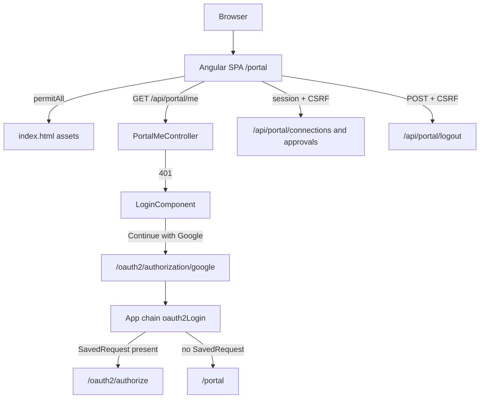

# Requirements

### Overview & Goals

Restyle the BroadWorks `/portal` Angular app so it looks and behaves like the EmailMCP portal, while keeping BroadWorks-specific flows (session-cookie BFF, set-password elicitation, URL-mode approvals, MCP Google login).

**Chosen direction (from you):**
- Branded login page whose only action is **Continue with Google** (no bearer-token field).
- Connection list as **cards**, not a table.
- Sticky header with **user chip + Sign out**.
- **Whole SPA public**; Angular calls `/api/portal/me` and the auth guard shows login on 401. MCP authorize still uses Spring SavedRequest.

### Scope

#### In Scope
- Port EmailMCP’s design system (CSS tokens, Inter, cards, buttons, badges, alerts, empty states, spinner, modal confirm).
- App shell: sticky branded header, footer, header/footer hidden on the login route.
- Login page, auth guard, 401 interceptor, `sessionStorage` return URL for deep links (especially `/portal/approvals/:id`).
- `GET /api/portal/me` and `POST /api/portal/logout`.
- Make `/portal/**` anonymous; keep `/api/portal/**` authenticated with CSRF.
- Restyle list, create/edit form, set-password, and approval pages.
- Replace `window.confirm` delete with an EmailMCP-style confirm dialog.

#### Out of Scope
- EmailMCP’s localStorage JWT / bearer-token login field.
- EmailMCP IMAP presets (encryption, TLS, port chips) — BroadWorks OCI has host/port/username only.
- Converting reactive forms to template-driven forms.
- Merging set-password into the main form (MCP elicitation still needs `/portal/:id/password`).
- Changing connection or approval API contracts (`needsPassword`, verify `{ success, message }`, etc.).

### User Stories

- As an unauthenticated user, I see a branded login page and continue with Google, then land in the portal.
- As a signed-in user, I see who I am and can sign out.
- As a user with no connections, I see an illustrated empty state and **Add connection**.
- As a user with connections, I see one card per connection with host/user, a **Needs password** badge, and Edit / Verify / Delete.
- As a user deleting a connection, I confirm in a modal, not a browser `confirm()`.
- As a user opening an approval deep link while logged out, I sign in and return to that approval.
- As an MCP client user, Google login for `/oauth2/authorize` still returns to the authorize URL, not `/portal`.

### Functional Requirements

- Unauthenticated HTML to `/portal` and `/portal/**` serves the SPA (no redirect to Google).
- Unauthenticated JSON to `/api/portal/**` still returns **401** (not a login redirect).
- Login CTA navigates to `/oauth2/authorization/google`.
- After Google with no SavedRequest, redirect to `/portal`. If SavedRequest exists (MCP), use it.
- Header shows email (and name/picture when present) and **Sign out**.
- Sign out invalidates the server session, then shows the login page.
- Approval, set-password, and connection CRUD behavior stay the same; only UX/chrome changes.

### Non-Functional Requirements

- Keep cookie session + `CookieCsrfTokenRepository` / Angular XSRF (`XSRF-TOKEN` → `X-XSRF-TOKEN`). Do not disable CSRF.
- Stay within Angular `anyComponentStyle` budgets (4kB warn / 8kB error) by putting the design system in `styles.css`, not huge component styles.
- Constructor injection, Java DTO `record`s, existing `oidcLogin()` test style.

# Technical Design

### Current Implementation

BroadWorks portal is an Angular 21 SPA (`src/main/frontend`, `baseHref` `/portal/`) with four screens and no login UI:

| Route | Component |
|---|---|
| `''` | `ConnectionsListComponent` — HTML table, `window.confirm` delete |
| `new`, `:id/edit` | `ConnectionFormComponent` — reactive form, single panel |
| `:id/password` | `SetPasswordComponent` |
| `approvals/:id` | `ApprovalComponent` |

Shell is a dark `<header>` + `<main>` in `app.html` / `app.css`. Global CSS is ~200 lines in `styles.css` (system fonts, table layout).

Auth today (`PortalSecurityConfig`, `@Order(1)`):
- Matcher: `/portal/**`, `/api/portal/**` — **all authenticated**.
- HTML → `LoginUrlAuthenticationEntryPoint("/oauth2/authorization/google")`.
- JSON → 401.
- CSRF cookie + `CsrfCookieFilter` (keep).
- **No logout**, no `/api/portal/me`, no user in the header.

Google callback lives on the **app** chain (`SecurityConfig` `@Order(2)`): `/oauth2/authorization/**` and `/login/oauth2/code/**` are public. Portal and MCP share that `oauth2Login`. There is no `defaultSuccessUrl`, so no SavedRequest → `/`.

EmailMCP reference (`/Users/jpuckett/source/git/EmailMCP/src/main/frontend`):
- `styles.css` design tokens, Inter, `.btn` / `.card` / `.badge` / empty states / spinner.
- `AppComponent` header (brand SVG, user chip, logout) + footer, hidden on `/login`.
- `LoginComponent`, `AuthService`, `authGuard`, `authInterceptor`, `ConfirmDialogComponent`.
- Card list (`AccountsListComponent`) instead of a table.

### Key Decisions

1. **SPA public, API private** — `permitAll` on `/portal/**`; `/api/portal/**` stays authenticated. Matches EmailMCP and the chosen login architecture.
2. **Keep session-cookie BFF** — no JWT in `localStorage`. Angular never sends `Authorization`; cookies + CSRF only.
3. **App-chain success URL** — `.defaultSuccessUrl("/portal", false)` on `SecurityConfig` `oauth2Login` so portal logins land on `/portal`, while MCP SavedRequest to `/oauth2/authorize` still wins. Do **not** set `alwaysUse=true`.
4. **Deep links via `sessionStorage`** — login stores `portalReturnUrl`; after `/api/portal/me` succeeds, navigate there (approvals).
5. **Design system in `styles.css`** — copy EmailMCP tokens/classes, BroadWorks copy/icons. Avoid EmailMCP-sized component style blobs.
6. **Keep reactive forms** and dedicated set-password + approval routes.

### Architecture Diagram



### Proposed Changes

#### Backend

**`PortalSecurityConfig`**
- `authorizeHttpRequests`: `/portal/**` `permitAll()`, `/api/portal/**` authenticated.
- Keep CSRF cookie repo + `CsrfCookieFilter`.
- HTML-vs-JSON entry point can stay (API 401); HTML portal pages will no longer hit it.
- `.logout(logout -> logout.logoutUrl("/api/portal/logout").logoutSuccessHandler(HttpStatusReturningLogoutSuccessHandler))` so POST returns 204.

**`SecurityConfig` (app chain only)**
- `.oauth2Login(...).defaultSuccessUrl("/portal", false)` — does not change MCP when SavedRequest exists.

**New `PortalMeController`** at `/api/portal/me`:
- `GET` → `MeResponse` from `@AuthenticationPrincipal OidcUser` (`email`, `name`, `picture`).
- Follow `PortalConnectionController` style; DTO is a Java record.

Do not extend `UserInfo` (that record is the tenant key). Me is display-only.

#### Frontend auth (EmailMCP pattern, cookie-based)

New files under `src/main/frontend/src/app/`:
- `auth.service.ts` — `GET /api/portal/me`, `POST /api/portal/logout`, `user` signal, `isAuthenticated`.
- `auth.guard.ts` — wait for `me()`, else `/login?returnUrl=`.
- `auth.interceptor.ts` — on 401 (except `/api/portal/me` and `/api/portal/logout`) clear user and go to login. **No Bearer header.**
- `login.component.ts` — EmailMCP-style card: title, short security copy (encrypted at rest, Google sign-in, passwords never returned), **Continue with Google** → stash return URL, `window.location.href = '/oauth2/authorization/google'`.

`app.config.ts`: keep XSRF config; add `withInterceptors`.

`app.routes.ts`: `login` public; all other routes `canActivate: [authGuard]`.

`app.ts` / `app.html`: port EmailMCP shell — brand SVG (server/network, not envelope), user chip, Sign out, footer. `@if (auth.isAuthenticated())` for header/footer (hidden on login).

#### UI restyle

- **`styles.css`**: port EmailMCP tokens (`--bg`, `--surface`, `--accent`, `--danger`, radii, shadows), `.btn`, `.card`, `.badge`, `.alert`, forms, spinner, empty-state. Swap copy to BroadWorks.
- **`index.html`**: Inter from Google Fonts; title stays “BroadWorks Credentials Portal”.
- **List**: cards with display name, `username@hostname:port`, `Needs password` badge, Edit / Verify / Delete. Empty state + spinner from EmailMCP.
- **Confirm dialog**: new `confirm-dialog.component.ts` (EmailMCP modal: title, message, Cancel, danger Confirm).
- **Form**: same reactive form and API; layout as sectioned cards (Connection details, Credentials with optional password, Test connection). Style verify `{ success, message }` as EmailMCP result boxes — do not invent extra check rows the API does not return.
- **Set-password & approval**: same behavior, card + alert + button chrome.

### Data Models / Contracts

```java
public record MeResponse(String email, String name, String picture) {}
```

```text
GET  /api/portal/me          → 200 MeResponse | 401
POST /api/portal/logout      → 204 (CSRF required)
```

Connection and approval JSON unchanged.

### File Structure

**Add**
- `src/main/java/co/pitayagroup/mcp/broadworks/web/portal/PortalMeController.java`
- `src/main/java/co/pitayagroup/mcp/broadworks/web/portal/dto/MeResponse.java`
- `src/test/java/co/pitayagroup/mcp/broadworks/web/portal/PortalMeControllerTest.java`
- `src/main/frontend/src/app/auth.service.ts`
- `src/main/frontend/src/app/auth.guard.ts`
- `src/main/frontend/src/app/auth.interceptor.ts`
- `src/main/frontend/src/app/login.component.ts`
- `src/main/frontend/src/app/confirm-dialog.component.ts`

**Modify**
- `PortalSecurityConfig.java`, `SecurityConfig.java`
- `PortalSecurityFilterChainTest.java`
- Frontend: `styles.css`, `index.html`, `app.ts`, `app.html`, `app.css`, `app.config.ts`, `app.routes.ts`, `app.spec.ts`
- `connections-list.component.ts`, `connection-form.component.ts`, `set-password.component.ts`, `approval.component.ts`
- Existing approval specs if selectors/copy change

### Risks

- **MCP login regression** — mitigated by `defaultSuccessUrl("/portal", false)` (SavedRequest first). Cover with existing authorize-flow tests if present; add a note in `PortalSecurityFilterChainTest`.
- **GET `/portal` in tests** — after `permitAll`, MockMvc hits `PortalSpaController` (forward to `index.html`). Do not require 200 if the SPA is not on the test classpath; assert **not** redirected to Google.
- **CSRF on logout** — POST with Angular XSRF; first authenticated `GET /me` already materializes the cookie via `CsrfCookieFilter`.
- **Style budget** — shared classes in `styles.css` only.

# Testing

### Validation Approach

Java: extend existing `@SpringBootTest` + `@AutoConfigureMockMvc` + `oidcLogin()` tests (see `PortalConnectionControllerTest`). Frontend: Vitest via `ng test`; update `app.spec.ts` and add focused specs for auth + login + confirm dialog.

### Key Scenarios

- Unauthenticated `GET /portal` (Accept: text/html) does **not** redirect to `/oauth2/authorization/google`.
- Unauthenticated `GET /api/portal/connections` and `GET /api/portal/me` return 401.
- Authenticated `GET /api/portal/me` with `oidcLogin()` returns email/name from the ID token.
- `POST /api/portal/logout` with `oidcLogin()` + CSRF returns 204; a follow-up `GET /me` is 401.
- `/mcp` still returns 401 with `WWW-Authenticate: Bearer` (portal chain must not swallow it).
- Login page renders “Continue with Google” and no token field.
- Guarded routes: unauthenticated list/form/approval navigation ends on `/login`.
- Connection cards render display name, host, and **Needs password**; empty list shows empty state; delete opens confirm dialog (no `window.confirm`).
- Approval confirm/deny still updates status (existing `approval.component.spec.ts`).

### Edge Cases

- Approval deep link while logged out: `returnUrl` survives Google (sessionStorage) and lands on `/approvals/:id`.
- Already-authenticated visit to `/login` can redirect to `''`.
- 401 on a connections call after session expiry sends the user to login without looping on `/api/portal/me`.
- `defaultSuccessUrl("/portal", false)` must not override a SavedRequest to `/oauth2/authorize`.

### Test Changes

- Update `PortalSecurityFilterChainTest.unauthenticatedPortalPageRedirectsToGoogleLogin` to the new anonymous-SPA assertion.
- Add `PortalMeControllerTest` (401, 200 body, logout).
- Update `app.spec.ts` (header is auth-gated; do not require `h1` BroadWorks Credentials Portal on the unauthenticated shell).
- Add `auth.service` / `login.component` / `confirm-dialog` specs.
- Keep approval service/component tests; adjust DOM selectors if classes change.

# Delivery Steps

### ✓ Step 1: Port design system and app shell
Global EmailMCP-style chrome is in place; existing screens still work with the new tokens.

- Rewrite `src/main/frontend/src/styles.css` with EmailMCP design tokens and shared classes (`.btn`, `.card`, `.badge`, `.alert`, forms, spinner, empty-state), using BroadWorks copy.
- Load Inter in `src/main/frontend/src/index.html`.
- Restyle `app.html` / `app.css` / `app.ts` to a sticky header (brand SVG + title) and footer; user chip and Sign out can be present but inert until auth lands.
- Point existing screens at the new utility classes so the table/form/approval pages are at least on-token (full card list and dialogs come later).
- Update `app.spec.ts` so it matches the new header markup.

### ✓ Step 2: Open the SPA and add me/logout APIs
Unauthenticated browsers can load `/portal`; session identity and logout exist as JSON APIs.

- In `PortalSecurityConfig`, `permitAll` `/portal/**` and keep `/api/portal/**` authenticated; add `logoutUrl("/api/portal/logout")` with `HttpStatusReturningLogoutSuccessHandler` (204). Leave CSRF cookie config as-is.
- In `SecurityConfig` app-chain `oauth2Login`, set `defaultSuccessUrl("/portal", false)` so MCP SavedRequest still wins.
- Add `PortalMeController` + `MeResponse` record (`GET /api/portal/me` from `@AuthenticationPrincipal OidcUser`).
- Rewrite `PortalSecurityFilterChainTest` HTML assertion (no Google redirect) and add `PortalMeControllerTest` for 401/200/logout using `oidcLogin()` + CSRF.

### ✓ Step 3: Add branded Google login and Angular auth
Visiting the portal while signed out shows the EmailMCP-style login page; after Google the header shows the user and Sign out works.

- Add `auth.service.ts`, `auth.guard.ts`, `auth.interceptor.ts` (cookie session only; interceptor must ignore 401 from `/api/portal/me` and `/api/portal/logout`).
- Register the interceptor next to existing XSRF config in `app.config.ts`.
- Add `login.component.ts` (Continue with Google only; stash `portalReturnUrl` in `sessionStorage`; navigate to `/oauth2/authorization/google`).
- Guard all routes except `login` in `app.routes.ts`; restore `portalReturnUrl` after a successful `me()`.
- Wire header user chip and Sign out to `AuthService`; hide header/footer on `/login`.
- Add Vitest coverage for auth service and login CTA.

### ✓ Step 4: Rebuild the connection list as cards
The home page matches EmailMCP: cards, empty/loading states, and a modal delete confirm.

- Add `confirm-dialog.component.ts` (title, message, Cancel, danger Confirm) modeled on EmailMCP’s dialog.
- Rewrite `connections-list.component.ts` from a table to a card per connection: display name, `username@hostname:port`, Needs password badge, Edit / Verify / Delete.
- Add EmailMCP-style empty state and loading spinner.
- Route Delete through the confirm dialog instead of `window.confirm`.
- Keep calling the existing `ConnectionsService` list/verify/delete APIs.

### ✓ Step 5: Restyle form, set-password, and approval pages
Create/edit, set-password, and approval screens use the same card/button/alert chrome without changing APIs or reactive forms.

- Restyle `connection-form.component.ts` into sectioned cards (details, credentials, test connection); keep the reactive form, port presets, and verify `{ success, message }` result boxes.
- Restyle `set-password.component.ts` as a focused card (elicitation URL unchanged).
- Restyle `approval.component.ts` with the same panel/alert/primary-danger buttons; keep Confirm/Deny behavior.
- Adjust approval component specs if DOM/CSS selectors change; do not change approval API semantics.