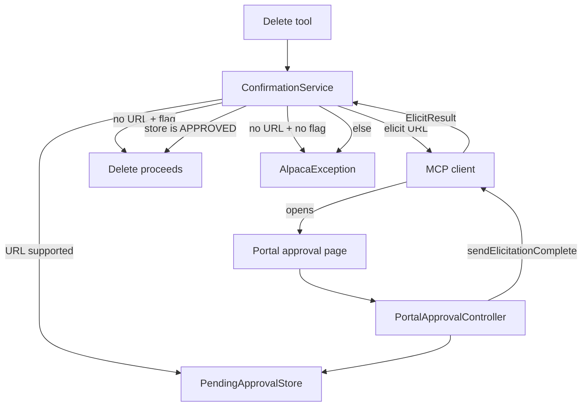

# Requirements

### Overview & Goals

Destructive BroadWorks deletes currently confirm with form-mode MCP elicitation (or `areYouSure=true`). An agent can auto-accept either path. This change uses MCP **URL-mode elicitation** so a human must Confirm or Deny on the existing Google-authenticated portal. The agent cannot approve the delete.

### Scope

#### In Scope
- All existing Are You Sure gates: `broadworks_delete_user`, `broadworks_delete_group`, `broadworks_delete_service_provider`, `broadworks_delete_service_pack`.
- When the MCP client advertises URL elicitation (`elicitation.url`): **always** send a portal approval URL and wait. Ignore `areYouSure`.
- When the client has no URL capability: refuse unless `areYouSure=true`. **No form elicitation** for approvals.
- Portal page at `/portal/approvals/{id}` (same Google subject as the MCP session).
- Unblock the waiting tool via `notifications/elicitation/complete`; proceed only if **our store** says that subject clicked Confirm.

#### Out of Scope
- Form-mode ID elicitation (`resolveUserId`, `resolveGroupRef`, etc.) stays as-is.
- Other mutations (create/update) do not gain confirmation.
- Durable / multi-instance approval storage (MCP sessions are already in-memory).
- Changing portal login or CSRF.

### User Stories

- As an admin using a URL-capable MCP client, I want delete tools to open a portal page I must click so the agent cannot silently destroy data.
- As an admin on a client without URL elicitation, I want a clear error telling me to use a URL-capable client or pass `areYouSure=true`.
- As the owner of the MCP session, I want another Google user who opens the approval URL to get 404, not my pending delete.

### Functional Requirements

- URL-capable client: create a pending approval, send `elicitation/create` with `mode=url` and `url={publicBase}/portal/approvals/{id}`, block until the client replies.
- Portal GET shows the action text and Confirm / Deny. POST records the decision, then `McpSyncServer.sendElicitationComplete(sessionId, elicitationId)`.
- After `elicit()` returns, the delete proceeds **only** if the store is `APPROVED` for that id + subject. Client `ACCEPT` alone is not enough.
- Deny, cancel, timeout, or client accept without a portal click → `AlpacaException`, no BroadWorks call.
- Fallback (no URL capability, `areYouSure` not true): error includes the action, tells the user to use a URL-capable client or set `areYouSure=true`, and says no changes were made.
- Pending approvals expire (15 minutes). Wrong subject, unknown id, and expired id all look like 404.

### Non-Functional Requirements

- Same-origin portal session + existing cookie CSRF (`XSRF-TOKEN`).
- Public URL from `PublicBaseUrlProperties.baseUrl()` (already `https://{hostname}` or `http://localhost:8080`).
- In-memory store only — the blocked `elicit()` and `sendElicitationComplete` must run on the same JVM as the MCP session.

# Technical Design

### Current Implementation

- `ToolElicitation.requireAreYouSure` (`src/main/java/co/pitayagroup/mcp/broadworks/mcp/tools/ToolElicitation.java`) skips confirmation when `areYouSure=true`; otherwise form-elicits `AreYouSure` or throws.
- Callers: `UserTools.deleteUser`, `GroupTools.deleteGroup`, `ServiceProviderTools.deleteServiceProvider`, `ServicePackTools.deleteServicePack` (all `@RequiredArgsConstructor` `@Component`s with only `AlpacaConnectionFactory` today).
- MCP Java SDK 0.17.0 already has `ElicitUrlRequest`, `ClientCapabilities.Elicitation.url`, and `McpSyncServer.sendElicitationComplete`. Spring AI `McpSyncRequestContext.elicit(ElicitRequest)` is the blocking send.
- Portal SPA (`/portal/**`) + JSON API (`/api/portal/**`) are Google `oauth2Login` + cookie CSRF (`PortalSecurityConfig`). `PortalSpaController` already forwards `/portal/{p1}/{p2}/{p3}` so `/portal/approvals/{id}` loads the SPA.
- `UserContext` / `UserInfo.subject` is the same Google `sub` on the MCP bearer principal and the portal OIDC user (`PortalConnectionController.currentSubject()`).

### Key Decisions

- **Always URL when supported; drop the flag.** If `clientCapabilities().elicitation().url() != null`, ignore `areYouSure` and always wait on the portal. `elicitEnabled()` is not enough — empty `elicitation: {}` is form-only.
- **No form fallback.** Form-mode `AreYouSure` is removed. Clients without URL mode must pass `areYouSure=true` or the delete is refused.
- **Spec request-response.** Tool blocks on `requestContext.elicit(ElicitUrlRequest)`. Portal records Confirm/Deny, then `sendElicitationComplete`. Tool trusts **our store**, not the client's `ElicitResult`.
- **New `ConfirmationService`.** `ToolElicitation` stays a static helper for missing IDs only. The four delete tools inject `ConfirmationService`.
- **In-memory `PendingApprovalStore`.** Matches in-memory MCP sessions. DynamoDB cannot deliver `sendElicitationComplete` to a session on another task.

### Proposed Changes



1. **Detect URL support** from `requestContext.clientCapabilities().elicitation().url()`.
2. **Create pending approval** `{elicitationId, subject, sessionId, action, PENDING, expiresAt}`.
3. **Send** `ElicitUrlRequest` with that `elicitationId`, `mode=url`, `url={baseUrl}/portal/approvals/{elicitationId}`, and a prompt/message that names the action.
4. **Portal GET/POST** `/api/portal/approvals/{id}` scoped to `UserContext.current().subject()`. POST `{ decision: "APPROVED" | "DECLINED" }` then `mcpSyncServer.sendElicitationComplete(sessionId, notification)`.
5. **After `elicit()` returns**, proceed only if the store is still `APPROVED` for that id and subject. Then delete the record.

`ConfirmationService` needs `PendingApprovalStore`, `PublicBaseUrlProperties`, and (for the portal complete path) `McpSyncServer`. Inject `McpSyncServer` (or `ObjectProvider<McpSyncServer>` if the Spring AI bean is optional in tests).

### Data Models / Contracts

```java
public enum ApprovalDecision { PENDING, APPROVED, DECLINED }

public record PendingApproval(
    String elicitationId,
    String subject,
    String sessionId,
    String action,
    ApprovalDecision decision,
    Instant expiresAt) {}

public interface PendingApprovalStore {
    void create(PendingApproval approval);
    Optional<PendingApproval> get(String elicitationId);
    Optional<PendingApproval> decide(String elicitationId, String subject, ApprovalDecision decision);
    void remove(String elicitationId);
}

// ConfirmationService
void requireAreYouSure(Boolean areYouSure, String action, McpSyncRequestContext ctx);

// GET /api/portal/approvals/{id}
record ApprovalResponse(String id, String action, String status) {}

// POST /api/portal/approvals/{id}
record ApprovalDecisionRequest(@NotNull ApprovalDecision decision) {}
```

`decide` is atomic: wrong/expired/missing subject → empty; already decided → return current row (idempotent same decision, conflict if flipped).

### Components

- **`ConfirmationService`** (new) — URL vs fallback policy; creates the pending row; sends `ElicitUrlRequest`; verifies store after unblock.
- **`InMemoryPendingApprovalStore`** — `ConcurrentHashMap`; treat expired as missing.
- **`PortalApprovalController`** — subject-scoped GET/POST; CSRF already on `/api/portal/**`.
- **`ApprovalComponent`** — Angular page matching `SetPasswordComponent` (signals, `HttpClient`, panel/btn styles).
- **Four delete tools** — `confirmationService.requireAreYouSure(...)`; update `@McpTool` / `@McpToolParam` copy.
- **`ToolElicitation`** — remove `requireAreYouSure` and `AreYouSure`.

### File Structure

**Add**
- `src/main/java/co/pitayagroup/mcp/broadworks/mcp/approval/PendingApproval.java`
- `src/main/java/co/pitayagroup/mcp/broadworks/mcp/approval/ApprovalDecision.java`
- `src/main/java/co/pitayagroup/mcp/broadworks/mcp/approval/PendingApprovalStore.java`
- `src/main/java/co/pitayagroup/mcp/broadworks/mcp/approval/InMemoryPendingApprovalStore.java`
- `src/main/java/co/pitayagroup/mcp/broadworks/mcp/approval/ConfirmationService.java`
- `src/main/java/co/pitayagroup/mcp/broadworks/web/portal/PortalApprovalController.java`
- `src/main/java/co/pitayagroup/mcp/broadworks/web/portal/dto/ApprovalResponse.java`
- `src/main/java/co/pitayagroup/mcp/broadworks/web/portal/dto/ApprovalDecisionRequest.java`
- `src/main/frontend/src/app/approval.component.ts`
- `src/main/frontend/src/app/approval.service.ts`
- Tests next to each of the above

**Modify**
- `UserTools.java`, `GroupTools.java`, `ServiceProviderTools.java`, `ServicePackTools.java` — inject service, swap call, refresh descriptions.
- `ToolElicitation.java` / `ToolElicitationTest.java` — drop Are You Sure helpers and tests.
- `UserToolsTest`, `GroupToolsTest`, `ServiceProviderToolsTest`, `ServicePackToolsTest` — `new *Tools(factory, confirmationService)` with a real or stubbed service (fallback path: `areYouSure=true` + null context still deletes).
- `src/main/frontend/src/app/app.routes.ts` — `{ path: 'approvals/:id', component: ApprovalComponent }`.
- `docs/mcp-tools-schema.md` — URL-first confirmation; `areYouSure=true` only when the client cannot do URL elicitation.

### Risks

- **Client never replies after complete.** Spec-compliant wait can hang until the MCP session dies. Mitigate with a 15-minute store TTL and a prompt that says the user can close the tab after clicking.
- **`sendElicitationComplete` on a closed session.** Catch and log; the blocked `elicit()` will fail on its own and the store will not be `APPROVED` unless the human already clicked.
- **Subject mismatch.** Portal OIDC `sub` and MCP opaque-token `sub` are the same Google subject today (`UserContext`). If either side lacks `UserInfo`, refuse rather than create an unbound approval.
- **Auto-accepting client.** Store stays `PENDING` → delete is refused. That is the security property.

# Testing

### Validation Approach

Unit-test the policy and store without a live MCP client. Use mocked `McpSyncRequestContext` / `McpSyncServer` for the URL path, and existing tool tests for the `areYouSure=true` fallback. Add a `@WebMvcTest` for the portal API following `PortalConnectionController` patterns (`UserContext` + CSRF).

### Key Scenarios

- URL capability present → `elicit(ElicitUrlRequest)` is called even when `areYouSure=true`; delete proceeds only if the store is `APPROVED` after return.
- URL capability present, store still `PENDING` after client `ACCEPT` → `AlpacaException`, no BroadWorks call.
- URL capability present, store `DECLINED` → `AlpacaException`.
- No URL capability + `areYouSure=true` → proceed; `elicit` never called.
- No URL capability + flag missing/false → error names the action and mentions a URL-capable client or `areYouSure=true`.
- Portal GET/POST: owner sees the action; other subject gets 404; Confirm sends `sendElicitationComplete` with the stored `sessionId` + `elicitationId`.
- Four existing `delete*RequiresAreYouSure` tests still pass on the fallback path (`requestContext == null`).

### Edge Cases

- Expired pending row treated as missing (tool refuses; portal 404).
- Idempotent POST of the same decision; conflicting second decision → 409.
- `UserContext` empty during a URL confirm → refuse, do not create an unbound row.
- `sendElicitationComplete` throws → API still returns 200 after a successful store write (client may already be gone).

### Test Changes

- Add `ConfirmationServiceTest`, `InMemoryPendingApprovalStoreTest`, `PortalApprovalControllerTest`.
- Remove Are You Sure cases from `ToolElicitationTest` (keep ID-elicitation tests).
- Update the four `*ToolsTest` constructors to pass `ConfirmationService` (real service + in-memory store is enough for fallback tests).

# Delivery Steps

### ✓ Step 1: Add PendingApprovalStore and ConfirmationService
URL vs fallback policy lives in ConfirmationService; pending approvals are stored in memory.

- Add `ApprovalDecision`, `PendingApproval`, `PendingApprovalStore`, and `InMemoryPendingApprovalStore` under `co.pitayagroup.mcp.broadworks.mcp.approval`.
- Store is a `ConcurrentHashMap` keyed by `elicitationId`; expired rows are treated as missing. TTL is 15 minutes.
- Add `@Service ConfirmationService` with `PendingApprovalStore` and `PublicBaseUrlProperties`.
- `requireAreYouSure(areYouSure, action, ctx)`: if `ctx.clientCapabilities().elicitation().url() != null`, create a pending row for `UserContext` subject + `ctx.sessionId()`, send `ElicitUrlRequest` (`mode=url`, `url={baseUrl}/portal/approvals/{id}`), then proceed only when the store is `APPROVED` for that subject.
- Otherwise proceed only when `areYouSure` is true; else throw `AlpacaException` (no form elicit).
- Add `ConfirmationServiceTest` and `InMemoryPendingApprovalStoreTest` covering URL-approved, URL-pending-after-accept, declined, fallback flag, and missing-flag error.

### ✓ Step 2: Switch the four delete tools off form-mode Are You Sure
Deletes go through ConfirmationService; form-mode AreYouSure is gone.

- Inject `ConfirmationService` into `UserTools`, `GroupTools`, `ServiceProviderTools`, and `ServicePackTools` (`@RequiredArgsConstructor`).
- Replace `ToolElicitation.requireAreYouSure(...)` with `confirmationService.requireAreYouSure(...)`.
- Update `@McpTool` / `@McpToolParam` text: URL-capable clients always get a portal prompt; `areYouSure=true` is only for clients without URL elicitation.
- Remove `requireAreYouSure` and the `AreYouSure` record from `ToolElicitation`; drop the matching tests in `ToolElicitationTest`.
- Update the four `*ToolsTest` constructors to `new *Tools(factory, confirmationService)` using a real service + in-memory store so existing `areYouSure=true` / null-context delete tests keep passing.

### ✓ Step 3: Add portal approval API and complete notification
Confirm/Deny on `/api/portal/approvals/{id}` records the decision and unblocks the MCP client.

- Add `ApprovalResponse` and `ApprovalDecisionRequest` DTOs.
- Add `PortalApprovalController` at `/api/portal/approvals` (same `/api/portal/**` security + CSRF as `PortalConnectionController`).
- GET `/{id}` returns `{ id, action, status }` for the current `UserContext` subject; unknown, expired, or other-subject ids are 404.
- POST `/{id}` with `{ decision }` calls `store.decide`, then `McpSyncServer.sendElicitationComplete(sessionId, ElicitationCompleteNotification)` using the stored session and elicitation ids.
- Inject `McpSyncServer` (or `ObjectProvider<McpSyncServer>`); if complete-notify throws, log and still return 200 after a successful write.
- Same decision twice is idempotent 200; a conflicting second decision is 409.
- Add `PortalApprovalControllerTest` (`@WebMvcTest` or standalone MockMvc) for owner GET/POST, 404 for the wrong subject, and verify `sendElicitationComplete` arguments.

### ✓ Step 4: Add Angular approval page and update tool docs
Opening the elicitation URL shows Confirm/Deny in the existing portal SPA.

- Add `approval.service.ts` calling `GET/POST /api/portal/approvals/{id}` (same-origin + Angular XSRF interceptor, like `ConnectionsService`).
- Add `ApprovalComponent` in the `SetPasswordComponent` style: load the action, Confirm / Deny buttons, success and error states.
- Register `{ path: 'approvals/:id', component: ApprovalComponent }` in `app.routes.ts`. `PortalSpaController` already forwards `/portal/approvals/{id}`.
- After a successful POST, tell the user they can close the tab; the waiting tool resumes via elicitation complete.
- Update `docs/mcp-tools-schema.md` for the four delete tools: URL-first portal confirmation; `areYouSure=true` only when the client cannot do URL elicitation.